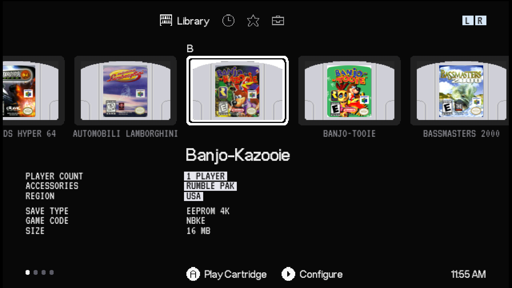

# SC64 A3D Library Menu

A 3DOS-style menu for the **SummerCart64**, designed for the **Analogue 3D**.



The menu replaces the stock SummerCart64 file list with a 3DOS-style screen. Your SD card's folders become a row of cartridges, and each game shows its own label art. Live game info sits under the cart, and the familiar Library, History, Favorites and Settings tabs run along the top. When you boot the SummerCart64 on an Analogue 3D, it feels like the console's own menu instead of a separate flashcart menu.

It is built on [N64FlashcartMenu](https://github.com/Polprzewodnikowy/N64FlashcartMenu) v0.3.5 and keeps all of its features: per-game settings, cheats, 64DD, Controller Pak tools, saves and fast reboot.

> Unofficial fan project built with CLAUDE. It is not affiliated with or endorsed by Analogue, Nintendo or the SummerCart64 / N64FlashcartMenu developers.

---

## What's in this folder

| Folder | Contents |
|---|---|
| `CHANGES-1.5.1.md` | What's new in 1.5.1 |
| `CHANGES-1.5.md` | What's new in 1.5 |
| `CHANGES-1.4.md` | What's new in 1.4 |
| `install/` | `sc64menu.n64` and `menu/library.ini`: everything that goes on the SD card |
| `source/` | Complete source (patch and git bundle) and how to use it |
| `licences/` | AGPL-3.0 (menu), and OFL 1.1 for the Analogue OS and VT323 fonts |
| `examples/` | Screenshots of the menu running on an Analogue 3D |
| `extras/` | Pixel test ROM, sprite baking script and development mockups |

## Screenshots

The `examples/` folder has screenshots taken on an Analogue 3D (with version 1.3, before the 1.4 label window, 64DD changes and 1.5 cart colours), rescaled to 16:9 as they appear on the TV:

| File | Screen |
|---|---|
| `01-library-folders.png`, `02-library-folders-japan.png` | Library folder row |
| `03-library-games.png` | A folder's games, with live info under the selected cart |
| `04-a-z-jump-bar.png` | A–Z jump bar (D-pad up) |
| `05-64dd-disks.png` | 64DD disk images |
| `06-configure-hardware.png`, `07-configure-customization.png` | Configure (C▶ on a game) |
| `08-choose-label.png` | Choose Label |
| `09-history.png` | History |
| `10-favorites-empty.png`, `11-favorites.png` | Favorites |
| `12-menu-settings.png`, `13-folder-order.png` | Menu Settings and Folder Order |

> The Analogue 3D's own screenshots save the menu at 1280×480, which looks squashed. These have been scaled to 2560×1440 (each pixel exactly 2 wide by 3 tall) so they match what you see on screen.

## Contents

1. [What you need](#what-you-need)
2. [Install](#install)
3. [Set up your SD card](#set-up-your-sd-card)
4. [Add cartridge labels](#add-cartridge-labels)
5. [Analogue 3D display settings](#analogue-3d-display-settings)
   - [Give ROM hacks their own Analogue 3D settings](#give-rom-hacks-their-own-analogue-3d-settings)
   - [Give 64DD disks their own Analogue 3D settings](#give-64dd-disks-their-own-analogue-3d-settings)
6. [Controls](#controls)
7. [Screens](#screens)
8. [Settings files](#settings-files)
9. [Updating and going back to the stock menu](#updating-and-going-back-to-the-stock-menu)
10. [Troubleshooting](#troubleshooting)
11. [Known limitations](#known-limitations)
12. [Building from source](#building-from-source)
13. [Credits and licences](#credits-and-licences)

---

## What you need

| Item | Requirement |
|---|---|
| Flashcart | SummerCart64, any revision |
| SummerCart64 firmware | **2.17 or newer**. Tested on 2.18.1. Check under Settings → Flashcart Information. |
| Console | Analogue 3D with its latest firmware. The menu also runs on a regular N64, but it is drawn for a 16:9 screen, so it looks squashed on a 4:3 TV. |
| Memory | Expansion Pak recommended. The Analogue 3D has one built in. |
| SD card | FAT32 or exFAT, the same card you already use in the SummerCart64 |
| Optional | `labels.db` from an Analogue 3D SD card, for cartridge label art |

The SummerCart64 firmware is updated separately with the official `sc64deployer` tool. This menu doesn't change it.

---

## Install

1. Turn off the console and take the SD card out of the SummerCart64.
2. **Back up the stock menu:** copy the `sc64menu.n64` file from the root of the card to your PC, Mac or another device, and rename that copy `sc64menu-stock.n64`. Don't keep the backup on the SD card, or it will show up as a cartridge in the Library.
3. Copy **`install/sc64menu.n64`** from this folder to the **root** of the SD card.
4. Copy **`install/menu/library.ini`** into the card's `menu` folder. Create the folder if it doesn't exist. This file is optional; without it the defaults below are used.
5. Optional: add `labels.db` for label art (see [Add cartridge labels](#add-cartridge-labels)).
6. Put the card back, turn on the console, and go to Settings → About. The menu version should read `0.3.5-library-…`.

Your existing saves, per-game settings, cheats, history and favourites carry over. They use the same files as the stock menu.

---

## Set up your SD card

Folders at the root of the card become the **folder row** of the Library tab. A suggested layout:

```
/                       (SD card root)
├── sc64menu.n64        this menu
├── US/                 USA games
├── EU/                 PAL games
├── JP/                 Japanese games
├── N64 DD/             64DD disk images
├── Hacks/              ROM hacks, homebrew
└── menu/               menu data (created automatically)
    ├── library.ini
    ├── labels.db
    └── label_overrides.ini
```

How folders appear:

- **Order:** folders listed in Folder Order come first, in that order. Any other folder follows A to Z. ROMs at the root of the card come last. Change the order in **Settings → Menu Settings → Folder Order**, or in `library.ini`.
- **Cart lettering:** each folder cart shows the first two letters or numbers of the folder name in capitals (US, EU, JP, HA…).
- **Names:** `US`/`USA`, `EU`/`EUR`/`PAL` and `JP`/`JPN`/`JAP` show as United States, Europe and Japan. Other folders show their own name.
- **64DD:** a folder with **DD**, **64DD** or **N64DD** as a separate word in its name (such as `N64 DD` or `64DD Games`) gets the 64DD disk shape. Names like "Addons" don't.
- **Hidden:** folders in `hide =` in `library.ini` (by default `cpak_saves`), the `menu` folder, the saves folder and hidden system folders.
- **Hide or unhide a folder from the menu:** on the folder row, press **C▶ → Hide this folder**. Turn on **Settings → Menu Settings → Show Hidden Folders** to see hidden folders again (dimmed), and use **C▶ → Unhide this folder** to bring one back for good.
- **Start-up folder:** the menu opens on the folder row by default. To open straight into a folder, use **C▶ → Open this folder at start-up** on the folder row, or **Settings → Menu Settings → Start In**.
- **Games only:** save, cheat, patch and text files are hidden from the Library.

You can use any folder names you like; the five above are only a suggestion.

---

## Add cartridge labels

The menu shows cartridge label art from **`labels.db`**, the label database the Analogue 3D itself uses.

1. On your **Analogue 3D's** SD card, find `/Library/N64/Images/labels.db`.
2. Copy it to the SummerCart64 card as **`/menu/labels.db`**.
   - The menu also looks in `/labels.db` and `/Library/N64/Images/labels.db` on the SummerCart64 card.
3. Restart the menu.

How labels are matched:

- Each ROM is matched by a checksum of its first 8 KB, the same method the Analogue 3D uses. `.z64`, `.v64` and `.n64` byte orders all work.
- Labels are scaled once, when they load, to their true shape (56×86 on screen), and fill the cart's label window exactly. The window has an arched top and a thin outline.
- **Cart colours:** each game's cart starts in its original release colour (for example gold Majora's Mask, yellow Donkey Kong 64, blue Tony Hawk's Pro Skater). Colours follow the region: most coloured carts were North American; PAL and Australian copies are coloured only where those releases were. Japanese carts are grey. Change a game's colour with C▶ → Customization → **Cart Colour**.
- A game with no match shows a **blank grey cartridge**.
- **Choose your own label:** on a game, press **C▶** and go to Customization → Choose Label. Your choices are saved in `/menu/label_overrides.ini`.

  | Button | Action |
  |---|---|
  | D-pad | Move label by label |
  | **L / R** | Previous / next page (14 labels) |
  | **C◀ / C▶** | Back / forward 10 pages |
  | **A** | Use the selected label |
  | **Z** | Clear your choice and go back to the automatic label |
  | **B** | Back |

  The top right shows the page and label number, and a bar at the bottom shows your place in the whole set. A game that already has a label opens on it; a game without one opens where you left off last time.

  labels.db has no game names, only a checksum and a picture for each label, so the labels are in no particular order.

`labels.db` is **not included** in this release, because the label artwork belongs to its publishers. Use the one from your own Analogue 3D. The community [labels.db editor](https://enoznal.com/3d/labels.html) can add or replace individual labels.

---

## Analogue 3D display settings

The menu draws a 640×480 picture designed to fill a 16:9 screen. Set these on the Analogue 3D for the **SummerCart64**:

| Setting | Value | Why |
|---|---|---|
| Display mode | **Clean** | No CRT or scanline filter, so pixel art and text stay sharp. |
| Image size | **Fill** | Fills the whole screen edge to edge, with no borders. |
| Image fit | **Stretch** | The menu is drawn for a stretched 16:9 picture. Carts, labels and text are pre-shaped so they look right once stretched. |

**These settings don't affect your games.** Each game in the Analogue 3D's library keeps its own display profile, so a game can still run in 4:3 with any filter you like while the menu fills the screen.

> **Exception: ROM hacks, homebrew and 64DD disks.** Games the Analogue 3D doesn't recognise from its own library have no profile of their own, and **inherit the SummerCart64's settings** (Stretch, Fill and Clean). The menu can fix this: see [Give ROM hacks their own Analogue 3D settings](#give-rom-hacks-their-own-analogue-3d-settings) and [Give 64DD disks their own Analogue 3D settings](#give-64dd-disks-their-own-analogue-3d-settings). Expansion disks played with their cartridge (such as F-Zero X + Expansion Kit) already use the cartridge's settings.

### Give ROM hacks their own Analogue 3D settings

The Analogue 3D keeps each game's settings in a folder on its SD card, `/Library/N64/Games/<title> <signature>/`. The signature is a checksum of the ROM's first 8 KB. It makes these folders itself for games it recognises, but not for ROM hacks, so they fall back to the SummerCart64's settings. The menu can make the folder for you:

1. On the game, press **C▶ → ROM Info**. At the bottom, **Signature** shows its code.
2. Scroll to the very bottom of ROM Info and choose **Create Analogue 3D Entry** (A). The menu writes `/a3d/Library/N64/Games/<title> <signature>/` on the **SummerCart64's** card, with `library.json` (title, players, accessories, region, cart colour) and `settings.json` (display and hardware settings).
3. Make entries for as many games as you like, then copy the **`Library`** folder from `/a3d` on the SummerCart64's card to the root of the **Analogue 3D's** card, merging it with the `Library` folder already there.
4. Boot the game from the menu as normal. It now uses its own settings, which you can change on the Analogue 3D; they're remembered, and the game appears in the Analogue 3D's Library.

**To use your own settings**, copy `settings.json` from any game folder on the Analogue 3D (one set up the way you like) into `/a3d/template/` on the SummerCart64's card. Every new entry then uses it, with the game's own cart colour. Without a template, each game first boots in Clean mode at 4:3 (Image fit: Original); change it to your preferred settings once on the Analogue 3D and it remembers them.

An entry only needs creating once per game. A new version of a hack has a new signature, so it needs its own entry: Smash Remix 2.0 and 3.0 each need one, for example. **Labels for hacks:** the entry doesn't include label art. To show a label for a hack in 3DOS, make one yourself and add it to your Analogue 3D's own `labels.db` (`/Library/N64/Images/labels.db`) under the game's signature, for example with the community [labels.db editor](https://enoznal.com/3d/labels.html). Copy the updated `labels.db` to the SummerCart64 card as `/menu/labels.db` too, and the hack shows the same label in this menu.

### Give 64DD disks their own Analogue 3D settings

The Analogue 3D recognises a game from the first 8 KB of cartridge space, and a disk boot doesn't change that, so on its own every disk would count as "SummerCart64". **Signature Boot** fixes this: just before a stand-alone disk boots, the menu puts a small cartridge header carrying the disk's game code into the cartridge space (which a disk boot doesn't use). The Analogue 3D then sees each disk as a game of its own. Create an entry for the disk (below) and it gets its own settings and Memories.

- Signature Boot is **on** for every disk that boots without a cartridge. To turn it off for one disk: **C▶ → Analogue 3D → Signature Boot**. Disks played with a Game Pak are never affected.
- **C▶ → Analogue 3D → Create Analogue 3D Entry** writes an entry for the disk to `/a3d` on the SummerCart64's card, exactly like the ROM hack entries above. Copy `/a3d/Library` to the Analogue 3D's card in the same way, and the disk appears in the Analogue 3D's Library with its title, release year and grey cart, with its own settings. Without an entry it still shows as SummerCart64.
- A disk's signature is the same every time. It is chosen so that it never matches a game in `labels.db`, the SummerCart64 itself or a blank cartridge.
- Release years are filled in for the released 64DD disks (Mario Artist, SimCity 64, Doshin the Giant, Japan Pro Golf Tour 64, Randnet). Other disks have no year.
- **Disks you made an entry for in the test builds:** to add the year, choose Create Analogue 3D Entry again and copy only the new **`library.json`** into the disk's folder on the Analogue 3D's card. Don't copy `settings.json`, or the disk's display settings go back to the defaults. Or open the existing `library.json` on a PC and add `"release_year": 1999,` (the disk's year) inside `"data"`.

In 4:3 mode the menu still works, but everything looks narrow.

---

## Controls

### Library, History and Favorites

| Button | Action |
|---|---|
| **L / R** | Switch tab: Library, History, Favorites, Settings |
| **D-pad / stick left and right** | Move along the cartridge row |
| **A** | Open a folder, or **play** the selected game straight away with its saved settings |
| **B** | Back up one folder |
| **C▶** | **Configure** the selected game (see below) |
| **D-pad up** | Open the **A–Z jump bar** inside a folder. Left and right pick a letter, A jumps, B or down closes it. Names starting with a number or symbol are under **#**. |
| **Start** | Settings |
| **C▲** (Favorites) | Remove the selected favourite |
| **C▲** (Library, while a 64DD Game Pak is set) | Clear the Game Pak |

### 64DD disks

| Button | Action |
|---|---|
| **A** on a disk | Boot it in one press. The disk decides how (below). |
| **C▶** on a disk | **Disk Options**, with three categories on the left. **Options**: Play Disk, Play with Game Pak, a Favorite switch and **Delete Disk** (A twice; keeps the save and the Game Pak). **Analogue 3D**: Signature Boot and Create Analogue 3D Entry. **Disk Info**: disk details, Game Pak and swap disks (up/down scroll). It opens on the categories: A or right enters one, B or left goes back to the categories, and B on the categories leaves. Also on disks in History and Favorites. |

- **Stand-alone disks** (game codes starting with D, such as Mario Artist, SimCity 64 and Doshin the Giant) always boot on their own.
- **Expansion disks** (F-Zero X Expansion Kit, Mario Party, Zelda, Pokémon Stadium 1 and 2 Japan, Dezaemon 3D) boot together with their cartridge, the **Game Pak**:
  1. On the cartridge (for example the Japanese F-Zero X), press **C▶ → Hardware → Use as 64DD Game Pak**. This option only appears on expandable cartridges (game codes starting with C). The menu jumps to your 64DD folder, and the footer shows *64DD GAME PAK: F-Zero X*.
  2. Press **A** on the expansion disk. With the matching Game Pak set, the pair boots straight away.
  3. If no Game Pak is set, or it's the wrong game or region, the menu says what's needed, for example *Needs F-Zero X (CFZJ), Japan region, as Game Pak*. You can then boot the disk alone or go back.
- The Game Pak stays set until you clear it (C▲ in the Library, or Clear 64DD Game Pak in the cartridge's Configure). Stand-alone disks ignore it.
- ROM + disk pairs saved in **History** or **Favorites** boot together in one press.
- 64DD games need the 64DD IPL files in `/menu/64ddipl` (see N64FlashcartMenu's 64DD guide), and expansion disks must match the cartridge's region.
- After a 64DD game, it can take **two presses of RESET** to get back to the menu. The first gives a blank screen. This comes from the stock N64FlashcartMenu, not from this menu.

History shows the 8 games played most recently. Favorites shows up to 8 games.

### Configure (C▶ on a game)

| Button | Action |
|---|---|
| **Up / down** | Move between categories, then between rows |
| **A / right** | Enter a category, or change, toggle or open a row |
| **Left / right** | Cycle a choice (CIC, save type, TV type) |
| **B** | Back |

Configure has four categories:
- **Hardware:** CIC, save type, TV type, Clear RAM, and **Use as 64DD Game Pak** on expandable cartridges
- **Cheats:** Use Cheats, the Datel code editor, and Show Cheat Files (applies to all games)
- **Customization:** Choose Label, **Cart Colour** (Original or any colour), Favorite, Reset Label, and **Delete Game** (press A twice to confirm; removes the game file and its History/Favorites entries; saves are kept)
- **ROM Info:** details from the ROM header, the Analogue 3D **Signature**, and **Create Analogue 3D Entry**

Settings are saved per game and used every time you press A to play.

---

## Screens

| Tab / screen | What's there |
|---|---|
| **Library** | Folder row, then that folder's cartridge row. The selected cart shows its title, players, accessories and region, plus save type, game code and size. |
| **History** | The 8 games played most recently, as a cartridge row |
| **Favorites** | Up to 8 favourite games. Add one with C▶ → Customization → Favorite. |
| **Settings** | Menu Settings, Date & Time, Controller Pak, Flashcart Information, N64 Information, About |
| **Menu Settings** | Folder Order, Start In, Show Hidden Folders, Show System Files, Show Saves, Show Text Files, Use Saves Folder, Fast Reboot ROM, PAL60, Sound Effects, Background Music, Reset |

Long titles and values scroll sideways automatically.

**Other files in the Library:**
- **Show Saves** shows the saves folder on the folder row and save files beside games, with the game's label; A shows their details.
- **Show Cheat Files** (in a game's Configure → Cheats, applies to all games) shows `.datel` / `.cht` files; A shows their details.
- **Show Text Files** shows `.txt`, `.ini` and `.yml` files; A opens them in the text viewer.

**Deleting:** C▶ on a file inside a folder offers **Delete selected entry…**, which asks you to confirm first. Folders on the folder row can't be deleted from the menu.

**Controller Pak:** up/down (or left/right) pick the controller. With a Pak in, A backs up the whole Pak, Z backs up one note and R opens options (delete a note, format, restore info). Backups go to `cpak_saves` (`.mpk`) and `cpak_saves/notes` (`.mpkn`); turn on Show Hidden Folders to open that folder, then A on a backup to restore it.

**Pop-ups:** option lists (C▶ on a folder or other file, the Controller Pak and Datel options) and messages appear as a dark rounded panel over the dimmed screen. The selected option is a white pill.

**Loading screens:** when a game loads, the screen shows its cartridge and label in the white selection frame, the title, and a thin progress bar with LOADING and the percentage. Everything else that takes time uses the same thin bar with a short message and percentage: 64DD disks, emulated ROMs, creating saves, extracting files and Controller Pak backups.

Along the bottom of every Library-style screen, as on 3DOS:

- **Controller dots (bottom left):** four dots, one for each controller port, 1 to 4 from left to right. A dot is **white when a controller is plugged into that port** and grey when the port is empty. They update live as you plug controllers in or out.
- **Button hints (middle):** the buttons that do something on the current screen.
- **Clock (bottom right):** 12-hour time from the SummerCart64's real-time clock. Set it in Settings → Date & Time.

---

## Settings files

All are plain text files on the SD card and safe to edit on a PC.

| File | Purpose |
|---|---|
| `/menu/library.ini` | Folder order and hidden folders (below) |
| `/menu/label_overrides.ini` | Labels you picked with Choose Label, cart colours you chose, and disks with Signature Boot turned off |
| `/a3d/` | Analogue 3D entries made with Create Analogue 3D Entry (games and disks), to copy to the Analogue 3D's card; `/a3d/template/settings.json` is your optional template |
| `/menu/labels.db` | Label art, copied from your Analogue 3D |
| `/menu/config.ini` and the per-game `.ini` files | Stock N64FlashcartMenu settings, unchanged |

`library.ini`:

```ini
[library]
; Folder order on the Library screen (folders not listed follow A to Z)
order = US, EU, JP, N64 DD, Hacks

; Folders to hide from the Library (comma-separated)
hide = cpak_saves
```

---

## Updating and going back to the stock menu

- **Update:** replace `sc64menu.n64` on the card with the newer one. Your settings files stay.
- **Go back to the stock menu:** copy your `sc64menu-stock.n64` backup from your PC, Mac or device back to the card root, rename it to `sc64menu.n64` (replacing this menu). If you have no backup, use the official `sc64menu.n64` from the [N64FlashcartMenu releases](https://github.com/Polprzewodnikowy/N64FlashcartMenu/releases). The stock menu ignores `library.ini`, `labels.db` and `label_overrides.ini`, so you can leave them.

---

## Troubleshooting

| Problem | Fix |
|---|---|
| Blue **CPU Assertion** screen | Take a photo and note the game and screen you were on. Report it with the version from Settings → About. |
| Every cart is blank grey | `labels.db` is missing or in the wrong place. It must be at `/menu/labels.db`. |
| Some carts are blank grey | That ROM dump isn't in `labels.db`, which often happens with PAL, Japanese or revised versions. Use Choose Label, or add the label with the labels.db editor. |
| Menu looks squashed, narrow or has borders | Set the SummerCart64 to Stretch, Fill and Clean (see [Analogue 3D display settings](#analogue-3d-display-settings)). |
| A folder is missing | It may be hidden: turn on Menu Settings → Show Hidden Folders, then C▶ → Unhide this folder. Also check Show Saves for the saves folder. |
| Folder in the wrong place | Settings → Menu Settings → Folder Order, or edit `order =` in `library.ini`. |
| "Directory is too large" | Use an Expansion Pak, or split the folder. |

---

## Known limitations

- The N64 outputs at most 640 pixels across. The Analogue 3D stretches this to 16:9, so each pixel is about a third wider than tall. Text uses fonts narrowed to compensate, which makes them slightly soft. Labels and carts are pre-shaped.
- All menu screens use the 3DOS style, except the image viewer, music player and emulator loading screens, which still use the stock layout.
- Text uses basic Latin characters only. Accented and Japanese characters show as spaces.
- Labels are drawn at 56×86 pixels, so fine label detail is limited by the N64's resolution.
- 64DD disks show a blank disk in the Library: there's no label art for disks yet.
- Cart colours have no Japanese data, so Japanese carts are grey. Australian carts that share Europe's game code use the European colour.
- Only what is in `labels.db` can be shown. There is no automatic download, and labels can't be searched by name.

---

## Building from source

The menu is an N64FlashcartMenu v0.3.5 fork. Source is provided as a patch against the `V0.3.5` tag (`source/sc64-library-source.patch` in this folder, with the full history in `source/sc64-library.bundle`) or from the project page, [JGSPL-dev/sc64-A3D-library-menu](https://github.com/JGSPL-dev/sc64-A3D-library-menu).

```bash
git clone --recurse-submodules https://github.com/Polprzewodnikowy/N64FlashcartMenu.git
cd N64FlashcartMenu
git checkout V0.3.5
git submodule update --init --recursive
git apply --binary /path/to/source/sc64-library-source.patch

# Toolchain: libdragon preview (see N64FlashcartMenu's README, or use its devcontainer/Docker image)
export N64_INST=/path/to/libdragon-toolchain
make MENU_VERSION='"0.3.5-library-1.5.1"'
# Output: output/sc64menu.n64
```

Useful files:
- `src/menu/ui_components/library_ui.c`: all 3DOS-style drawing
- `src/menu/views/browser.c`: the Library, from line 570 on
- `src/menu/views/library_*.c` and `label_picker.c`: Configure, Settings and label picker screens
- `src/menu/labels_db.c`: the labels.db reader
- `tools/bake_sprites.py`: pre-renders the cartridge and disk art

---

## Credits and licences

- **N64FlashcartMenu** by Robin Jones (NetworkFusion), Mateusz Faderewski (Polprzewodnikowy) and contributors, licensed under **AGPL-3.0**. This menu is a modified version and is also **AGPL-3.0**. Anyone you give `sc64menu.n64` to is entitled to its source code (see `source/SOURCE.md`).
- **libdragon**: Unlicense / public domain.
- **Analogue OS font** by AbFarid, a community recreation: SIL Open Font License 1.1 (`AnalogueOS-OFL.md`). The menu also ships 75%-width versions made from it.
- **VT323** by Peter Hull: SIL Open Font License 1.1 (`VT323-OFL.txt`). The menu also ships a 75%-width version.
- **3DOS layout:** inspired by the Analogue 3D's menu. Analogue and Analogue 3D are trademarks of Analogue Inc.; Nintendo 64 is a trademark of Nintendo. No Analogue or Nintendo artwork is included.
